# Laporan Resmi Praktikum Modul 5
### Komunikasi Data & Jaringan Komputer 2026

**Kelompok:** K-02  
**Prefix IP Kelompok:** `192.212.x.x` (Root Block: `192.212.0.0/21`)  
**Tema:** *Operation Geofront* (VLSM, Static Routing, NAT, dan Firewall `iptables`)  
**Spreadsheet VLSM:** [`Spreadsheet Modul 5 Komdat Jarkom 2026 K02.xlsx`](./Spreadsheet%20Modul%205%20Komdat%20Jarkom%202026%20K02.xlsx)  
**Direktori Skrip (`/root`):** [`scripts/`](./scripts/)

| Nama | NRP | Pembagian Pengerjaan |
| :--- | :--- | :--- |
| Maulana Zaki Putra Zakaria | 5027251009 | Bagian 1: Soal 1 – 12 (VLSM, Topologi, Routing, NAT, Layanan, Sabotase, Hardening Casper) |
| Naila Anggun Eka Rizqy | 5027251122 | Bagian 2: Soal 13 – 20 (Brankas Balthasar, Pen-Pen, Tokyo3-Core, DNAT, Zona Sensitif, Isolasi, Uji Kebakaran) |

---

## Daftar Isi
- [Topologi Jaringan Geofront](#topologi-jaringan-geofront)
- [Babak 1: Membangun Geofront (Soal 1 – 8)](#babak-1-membangun-geofront-soal-1--8)
  - [Soal 1 — Markas Tanpa Peta (VLSM & Pohon IP)](#soal-1--markas-tanpa-peta-vlsm--pohon-ip)
  - [Soal 2 — Geofront Gelap Gulita](#soal-2--geofront-gelap-gulita)
  - [Soal 3 — Pulau-Pulau yang Terpisah](#soal-3--pulau-pulau-yang-terpisah)
  - [Soal 4 — Haus Kabar dari Dunia Luar](#soal-4--haus-kabar-dari-dunia-luar)
  - [Soal 5 — Pintu Depan Dikunci Rapat](#soal-5--pintu-depan-dikunci-rapat)
  - [Soal 6 — Alamat Para Pilot](#soal-6--alamat-para-pilot)
  - [Soal 7 — Membangunkan MAGI](#soal-7--membangunkan-magi)
  - [Soal 8 — Mengenali Kondisi Normal](#soal-8--mengenali-kondisi-normal)
- [Babak 2: Sabotase dan Hantu MAGI (Soal 9 – 12)](#babak-2-sabotase-dan-hantu-magi-soal-9--12)
  - [Soal 9 — Jalur Belakang Diutak-Atik](#soal-9--jalur-belakang-diutak-atik)
  - [Soal 10 — Para Pilot Terkunci di Dalam](#soal-10--para-pilot-terkunci-di-dalam)
  - [Soal 11 — Casper Harus Jadi Hantu](#soal-11--casper-harus-jadi-hantu)
  - [Soal 12 — Teknisi yang Kelewat Semangat](#soal-12--teknisi-yang-kelewat-semangat)
- [Babak 3 & Final: Mengamankan MAGI, Zona Sensitif & Uji Kebakaran (Soal 13 – 20)](#babak-3--final-mengamankan-magi-zona-sensitif--uji-kebakaran-soal-13--20)

---

## Topologi Jaringan Geofront

Jaringan **Operation Geofront** terdiri dari **17 router** (router pusat **`Gendou`** sebagai satu-satunya pintu keluar ke `NAT1` beserta 16 router di bawahnya), **17 LAN switch**, dan **25 host container** (total 42 container menggunakan `ardhptr21/debinet:latest`).

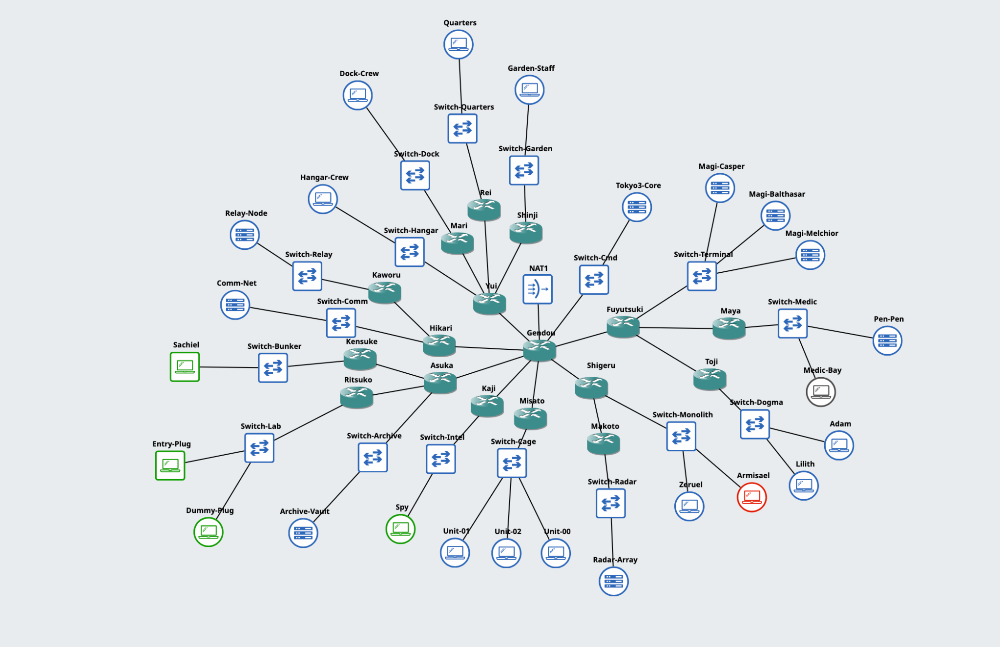

---

# Babak 1: Membangun Geofront (Soal 1 – 8)

## Soal 1 — Markas Tanpa Peta (VLSM & Pohon IP)

> Dikerjakan oleh Maulana Zaki Putra Zakaria

### Deskripsi Soal
> Bagi prefix IP kelompok (`192.212.x.x`) dengan VLSM untuk **17 LAN dan 16 link antar-router**, urut dari kebutuhan terbesar (tie-break: ukuran sama → LAN dulu daripada link → urutan tabel). Tunjukkan tabel berisi network, prefix, gateway, broadcast, IP terpakai, dan sisa, serta gambar pohon IP dengan subnet jalur `Dummy-Plug` ke `Armisael` dilingkari. Jelaskan hitungan satu subnet.

### Tabel Pembagian VLSM Lengkap (33 Subnet — Prefix `192.212.x.x`)

Seluruh 33 subnet (17 LAN + 16 link point-to-point `/30`) dialokasikan secara berurutan tanpa overlap mulai dari **`192.212.0.0`** hingga **`192.212.4.171`** (total **1.196 IP** di dalam Root Block `192.212.0.0/21`). Baris bertanda **`🔴`** merupakan 5 subnet pada jalur **`Dummy-Plug` → `Armisael`**.

| No | Kode | Subnet / Link | Gateway / Ujung | Network | Prefix | Gateway / IP #1 | Broadcast | Usable | IP Terpakai | Sisa |
| :---: | :---: | :--- | :--- | :---: | :---: | :---: | :---: | :---: | :---: | :---: |
| 1 | S1 | Switch-Quarters | Rei | `192.212.0.0` | `/23` | `192.212.0.1` | `192.212.1.255` | 510 | 501 | 9 |
| 2 | S2 | Switch-Comm | Hikari | `192.212.2.0` | `/24` | `192.212.2.1` | `192.212.2.255` | 254 | 201 | 53 |
| 3 | S3 | Switch-Hangar | Yui | `192.212.3.0` | `/25` | `192.212.3.1` | `192.212.3.127` | 126 | 101 | 25 |
| 4 | S4 | Switch-Bunker | Kensuke | `192.212.3.128` | `/26` | `192.212.3.129` | `192.212.3.191` | 62 | 56 | 6 |
| 5 | S5 | Switch-Medic | Maya | `192.212.3.192` | `/27` | `192.212.3.193` | `192.212.3.223` | 30 | 27 | 3 |
| 6 | S6 | Switch-Relay | Kaworu | `192.212.3.224` | `/27` | `192.212.3.225` | `192.212.3.255` | 30 | 26 | 4 |
| 7 | S7 | Switch-Garden | Shinji | `192.212.4.0` | `/27` | `192.212.4.1` | `192.212.4.31` | 30 | 15 | 15 |
| 8 | S8 | Switch-Dock | Mari | `192.212.4.32` | `/28` | `192.212.4.33` | `192.212.4.47` | 14 | 13 | 1 |
| 9 | **S9** 🔴 | **Switch-Lab (Hop 1)** | **Ritsuko** | **`192.212.4.48`** | **`/29`** | **`192.212.4.49`** | **`192.212.4.55`** | **6** | **6** | **0** |
| 10 | S10 | Switch-Terminal | Fuyutsuki | `192.212.4.56` | `/29` | `192.212.4.57` | `192.212.4.63` | 6 | 4 | 2 |
| 11 | S11 | Switch-Cage | Misato | `192.212.4.64` | `/29` | `192.212.4.65` | `192.212.4.71` | 6 | 4 | 2 |
| 12 | S12 | Switch-Dogma | Toji | `192.212.4.72` | `/29` | `192.212.4.73` | `192.212.4.79` | 6 | 3 | 3 |
| 13 | **S13** 🔴 | **Switch-Monolith (Hop 5)** | **Shigeru** | **`192.212.4.80`** | **`/29`** | **`192.212.4.81`** | **`192.212.4.87`** | **6** | **3** | **3** |
| 14 | S14 | Switch-Radar | Makoto | `192.212.4.88` | `/29` | `192.212.4.89` | `192.212.4.95` | 6 | 5 | 1 |
| 15 | S15 | Switch-Archive | Asuka | `192.212.4.96` | `/30` | `192.212.4.97` | `192.212.4.99` | 2 | 2 | 0 |
| 16 | S16 | Switch-Intel | Kaji | `192.212.4.100` | `/30` | `192.212.4.101` | `192.212.4.103` | 2 | 2 | 0 |
| 17 | S17 | Switch-Cmd | Gendou | `192.212.4.104` | `/30` | `192.212.4.105` | `192.212.4.107` | 2 | 2 | 0 |
| 18 | L1 | Link Gendou–Yui | Gendou ↔ Yui | `192.212.4.108` | `/30` | `192.212.4.109` | `192.212.4.111` | 2 | 2 | 0 |
| 19 | L2 | Link Gendou–Hikari | Gendou ↔ Hikari | `192.212.4.112` | `/30` | `192.212.4.113` | `192.212.4.115` | 2 | 2 | 0 |
| 20 | **L3** 🔴 | **Link Gendou–Asuka (Hop 3)** | **Gendou ↔ Asuka** | **`192.212.4.116`** | **`/30`** | **`192.212.4.117`** | **`192.212.4.119`** | **2** | **2** | **0** |
| 21 | L4 | Link Gendou–Kaji | Gendou ↔ Kaji | `192.212.4.120` | `/30` | `192.212.4.121` | `192.212.4.123` | 2 | 2 | 0 |
| 22 | L5 | Link Gendou–Misato | Gendou ↔ Misato | `192.212.4.124` | `/30` | `192.212.4.125` | `192.212.4.127` | 2 | 2 | 0 |
| 23 | **L6** 🔴 | **Link Gendou–Shigeru (Hop 4)** | **Gendou ↔ Shigeru** | **`192.212.4.128`** | **`/30`** | **`192.212.4.129`** | **`192.212.4.131`** | **2** | **2** | **0** |
| 24 | L7 | Link Gendou–Fuyutsuki | Gendou ↔ Fuyutsuki | `192.212.4.132` | `/30` | `192.212.4.133` | `192.212.4.135` | 2 | 2 | 0 |
| 25 | L8 | Link Yui–Rei | Yui ↔ Rei | `192.212.4.136` | `/30` | `192.212.4.137` | `192.212.4.139` | 2 | 2 | 0 |
| 26 | L9 | Link Yui–Shinji | Yui ↔ Shinji | `192.212.4.140` | `/30` | `192.212.4.141` | `192.212.4.143` | 2 | 2 | 0 |
| 27 | L10 | Link Yui–Mari | Yui ↔ Mari | `192.212.4.144` | `/30` | `192.212.4.145` | `192.212.4.147` | 2 | 2 | 0 |
| 28 | L11 | Link Hikari–Kaworu | Hikari ↔ Kaworu | `192.212.4.148` | `/30` | `192.212.4.149` | `192.212.4.151` | 2 | 2 | 0 |
| 29 | L12 | Link Asuka–Kensuke | Asuka ↔ Kensuke | `192.212.4.152` | `/30` | `192.212.4.153` | `192.212.4.155` | 2 | 2 | 0 |
| 30 | **L13** 🔴 | **Link Asuka–Ritsuko (Hop 2)** | **Asuka ↔ Ritsuko** | **`192.212.4.156`** | **`/30`** | **`192.212.4.157`** | **`192.212.4.159`** | **2** | **2** | **0** |
| 31 | L14 | Link Fuyutsuki–Maya | Fuyutsuki ↔ Maya | `192.212.4.160` | `/30` | `192.212.4.161` | `192.212.4.163` | 2 | 2 | 0 |
| 32 | L15 | Link Fuyutsuki–Toji | Fuyutsuki ↔ Toji | `192.212.4.164` | `/30` | `192.212.4.165` | `192.212.4.167` | 2 | 2 | 0 |
| 33 | L16 | Link Shigeru–Makoto | Shigeru ↔ Makoto | `192.212.4.168` | `/30` | `192.212.4.169` | `192.212.4.171` | 2 | 2 | 0 |

### Penjelasan Hitungan Satu Subnet (`Switch-Garden` — S7)
1. **Kebutuhan Alamat:** `Switch-Garden` (di bawah router `Shinji`) melayani `Garden-Staff = 14` host ditambah `1` alamat untuk gateway router `Shinji`, sehingga total kebutuhan alamat usable adalah $14 + 1 = 15\text{ IP}$.
2. **Menentukan Jumlah Bit Host ($h$) & Prefix:** Kita mencari nilai $h$ terkecil yang memenuhi $2^h - 2 \ge 15$:
   - Jika $h = 4$ (`/28`): $2^4 - 2 = 14$ usable IP (tidak cukup karena kurang 1 IP).
   - Jika $h = 5$ (`/27`): $2^5 - 2 = 30$ usable IP (cukup dan merupakan prefix terkecil yang muat).
   - Maka dipilih prefix **`/27`** ($32 - 5 = 27$), netmask desimal **`255.255.255.224`**, dengan ukuran blok $2^5 = 32$ alamat.
3. **Menentukan Alamat Network, Gateway, Broadcast, dan Sisa:**
   - Subnet sebelumnya (`S6: Switch-Relay`) adalah `192.212.3.224/27` yang berakhir di `192.212.3.255`.
   - Maka `S7: Switch-Garden` dimulai pada alamat kelipatan 32 berikutnya: **`192.212.4.0/27`**.
   - **Gateway (`Shinji eth1`):** IP usable pertama = **`192.212.4.1`**.
   - **Host (`Garden-Staff`):** IP usable kedua = **`192.212.4.2`**.
   - **Broadcast:** $192.212.4.0 + 32 - 1 =$ **`192.212.4.31`**.
   - **Sisa IP Usable:** $30 - 15 =$ **`15` IP**.

### Pohon Pembagian IP VLSM (Jalur `Dummy-Plug` → `Armisael` Dilingkari)

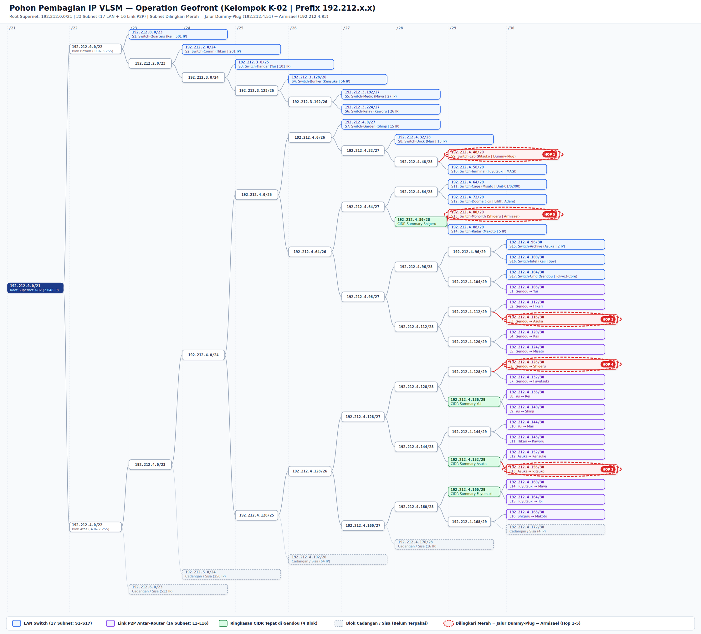

*Lima subnet pada jalur `Dummy-Plug` (`192.212.4.51`) → `Ritsuko` → `Asuka` → `Gendou` → `Shigeru` → `Armisael` (`192.212.4.83`) dilingkari merah: `192.212.4.48/29` (Hop 1), `192.212.4.156/30` (Hop 2), `192.212.4.116/30` (Hop 3), `192.212.4.128/30` (Hop 4), dan `192.212.4.80/29` (Hop 5).*

### Bukti Topologi GNS3
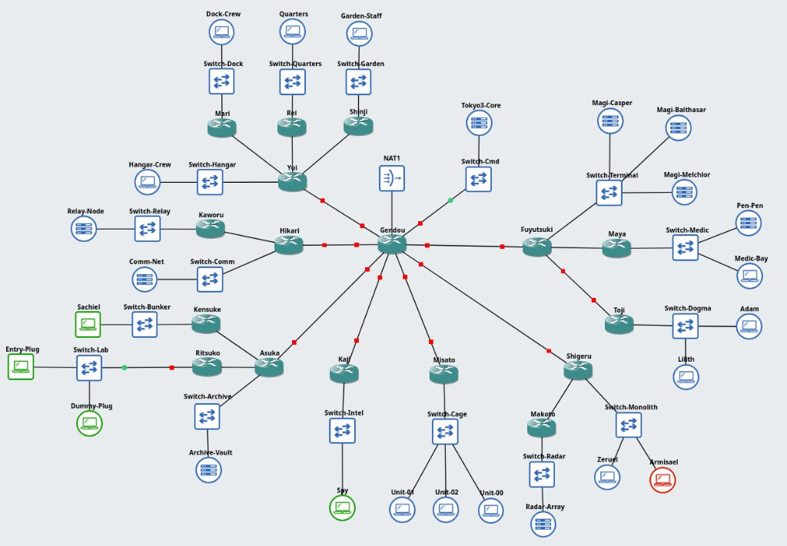
*Topologi jaringan Operation Geofront pada GNS3 kelompok K-02: 1 NAT (`NAT1`), 17 router (`Gendou` dan 16 router di bawahnya), 17 Ethernet switch, serta 25 host container (`ardhptr21/debinet:latest`) terpasang sesuai rancangan soal.*

---

## Soal 2 — Geofront Gelap Gulita

> Dikerjakan oleh Maulana Zaki Putra Zakaria

### Implementasi
- Seluruh 17 router dikonfigurasi menggunakan [`scripts/soal-2-router-ip.sh`](./scripts/soal-2-router-ip.sh) dengan konvensi seragam: `eth0` sebagai uplink (DHCP `NAT1` pada `Gendou`, parent router pada 16 router lainnya), `eth1` sebagai gateway LAN switch, dan `eth2+` menuju child router.
- IPv4 forwarding diaktifkan di seluruh 17 router (`sysctl -w net.ipv4.ip_forward=1`).

### Bukti dan Hasil
Pengujian dilakukan pada router pusat (`Gendou`), seluruh 5 router cabang Level 1 (`Yui`, `Fuyutsuki`, `Asuka`, `Shigeru`, `Hikari`), dan perwakilan leaf router Level 2 (`Ritsuko`) sehingga **seluruh 16 link router-ke-router teruji dua arah dengan 0% packet loss** dan `net.ipv4.ip_forward = 1` aktif.

1. **Router Pusat `Gendou` (`ip -br -4 a`, `ip_forward=1`, & Ping ke 7 Router Level 1):**
   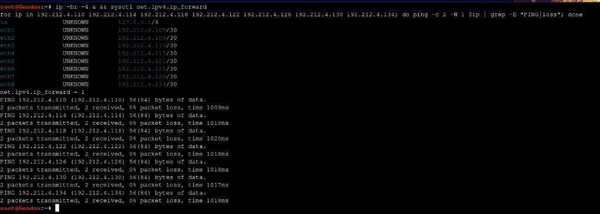
   *Seluruh 7 link Level 1 (`Yui`, `Hikari`, `Asuka`, `Kaji`, `Misato`, `Shigeru`, `Fuyutsuki`) berhasil di-ping dengan 0% packet loss.*

2. **Router Cabang `Yui` (5 Interface & Ping ke `Gendou`, `Rei`, `Shinji`, `Mari`):**
   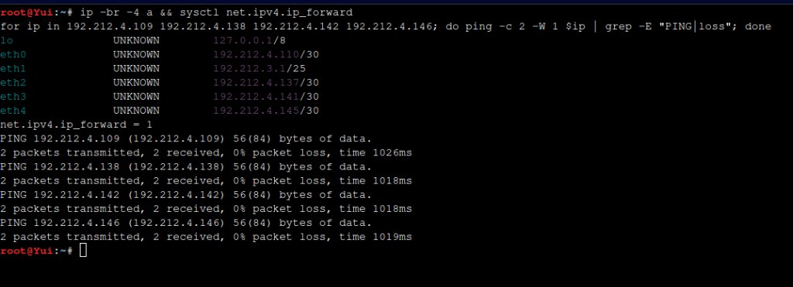

3. **Router Cabang `Fuyutsuki` (4 Interface & Ping ke `Gendou`, `Maya`, `Toji`):**
   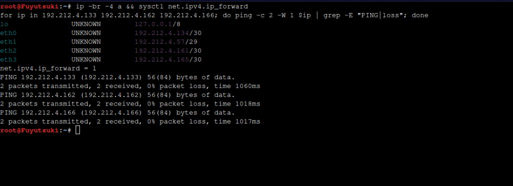

4. **Router Cabang `Asuka` (4 Interface & Ping ke `Gendou`, `Kensuke`, `Ritsuko`):**
   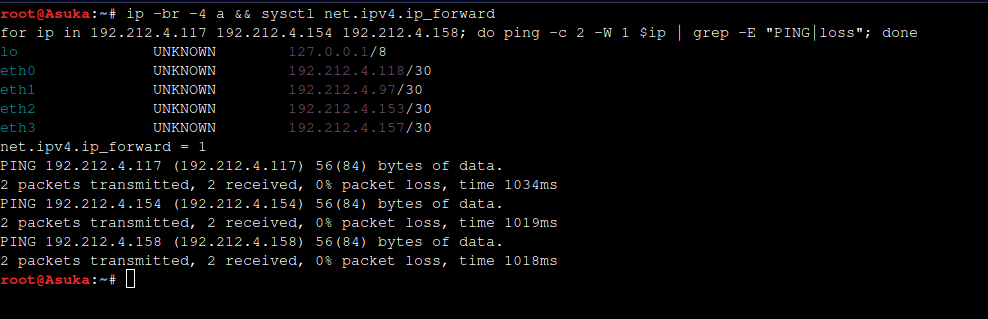

5. **Router Cabang `Shigeru` (3 Interface & Ping ke `Gendou`, `Makoto`):**
   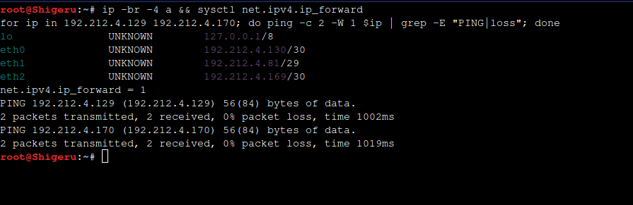

6. **Router Cabang `Hikari` (3 Interface & Ping ke `Gendou`, `Kaworu`):**
   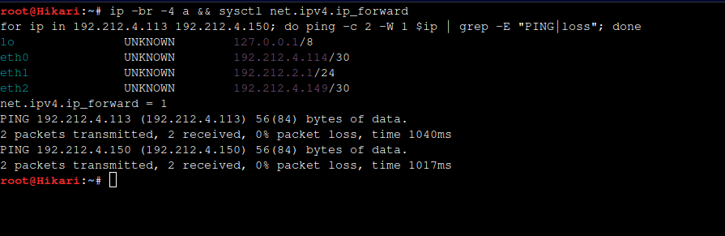

7. **Perwakilan Leaf Router Level 2 `Ritsuko` (2 Interface & Ping Balik ke `Asuka`):**
   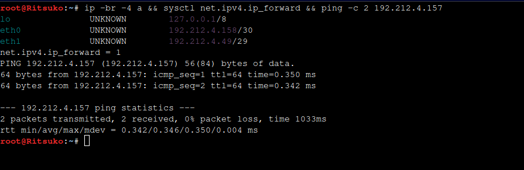

---

## Soal 3 — Pulau-Pulau yang Terpisah

> Dikerjakan oleh Maulana Zaki Putra Zakaria

### Implementasi & Ringkasan CIDR
Seluruh 17 router dikonfigurasi menggunakan [`scripts/soal-3-routing.sh`](./scripts/soal-3-routing.sh):
- **11 Leaf Router** (`Kaji`, `Misato`, `Rei`, `Shinji`, `Mari`, `Kaworu`, `Kensuke`, `Ritsuko`, `Maya`, `Toji`, `Makoto`) masing-masing hanya memerlukan **1 default route ke atas**.
- **5 Branch Router Level 1** (`Yui`, `Hikari`, `Asuka`, `Shigeru`, `Fuyutsuki`) memiliki **1 default route ke Gendou** + rute spesifik subnet di bawahnya.
- **Gendou** memiliki default route ke `NAT1` + **21 static route** (diringkas dari 25 rute mentah melalui **4 penggabungan CIDR tepat**):

| Cabang (Next-Hop) | Subnet Asal 1 | Subnet Asal 2 | Hasil Ringkasan CIDR |
| :--- | :--- | :--- | :---: |
| **Shigeru** (`192.212.4.130`) | `192.212.4.80/29` (Switch-Monolith) | `192.212.4.88/29` (Switch-Radar) | **`192.212.4.80/28`** |
| **Yui** (`192.212.4.110`) | `192.212.4.136/30` (Link Yui–Rei) | `192.212.4.140/30` (Link Yui–Shinji) | **`192.212.4.136/29`** |
| **Asuka** (`192.212.4.118`) | `192.212.4.152/30` (Link Asuka–Kensuke) | `192.212.4.156/30` (Link Asuka–Ritsuko) | **`192.212.4.152/29`** |
| **Fuyutsuki** (`192.212.4.134`) | `192.212.4.160/30` (Link Fuyutsuki–Maya) | `192.212.4.164/30` (Link Fuyutsuki–Toji) | **`192.212.4.160/29`** |

### Bukti dan Hasil
1. **Tabel Routing `Gendou` (`default` ke `NAT1` + 21 static route termasuk 4 ringkasan CIDR tepat):**
   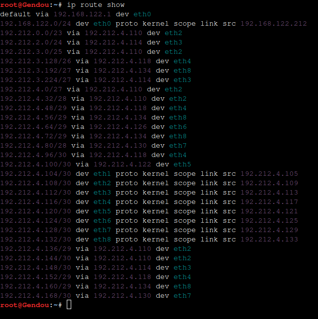
   *Terlihat default route ke `192.168.122.1` (`eth0`) serta keempat rute ringkasan CIDR tepat: `192.212.4.80/28` (Shigeru), `192.212.4.136/29` (Yui), `192.212.4.152/29` (Asuka), dan `192.212.4.160/29` (Fuyutsuki).*

2. **Tabel Routing Perwakilan Router Cabang (`Yui`, `Shigeru`) dan Leaf Router (`Ritsuko`):**
   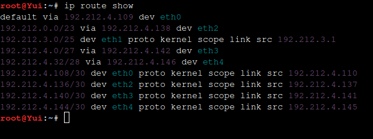
   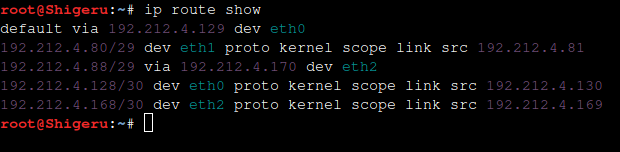
   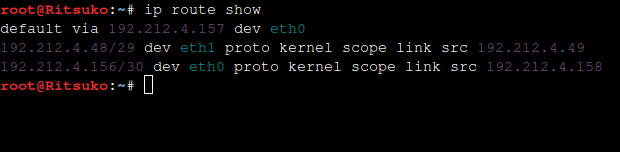
   *Router cabang hanya memiliki 1 default route ke `Gendou` ditambah rute subnet di bawahnya, sedangkan leaf router (`Ritsuko`) cukup memiliki 1 default route ke `Asuka`.*

3. **Uji Ping Lintas Cabang dari `Armisael` (`192.212.4.83`) ke `Lilith`, `Sachiel`, dan `Comm-Net`:**
   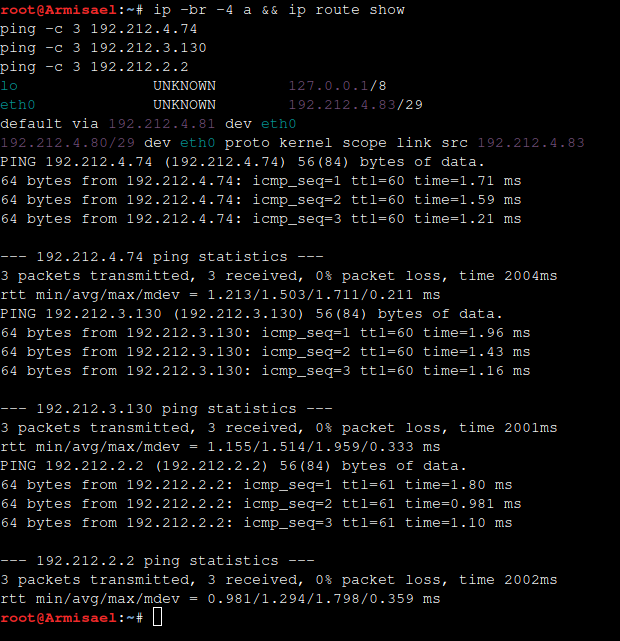
   *`Armisael` berhasil melakukan ping ke `Lilith` (`192.212.4.74`, 4 hop router `ttl=60`), `Sachiel` (`192.212.3.130`, 4 hop router `ttl=60`), dan `Comm-Net` (`192.212.2.2`, 3 hop router `ttl=61`) dengan 0% packet loss.*

---

## Soal 4 — Haus Kabar dari Dunia Luar

> Dikerjakan oleh Maulana Zaki Putra Zakaria

### Implementasi
Konfigurasi diterapkan melalui [`scripts/soal-4-nat.sh`](./scripts/soal-4-nat.sh) di `Gendou`:
```sh
iptables -t nat -A POSTROUTING -s 192.212.0.0/16 -o eth0 -j MASQUERADE
```
- Target **`MASQUERADE`** dipakai agar translasi otomatis mengikuti IP `eth0` dari DHCP `NAT1` meski IP berubah.
- Kriteria **`-s 192.212.0.0/16 -o eth0`** memastikan hanya trafik dari prefix internal menuju internet (`eth0`) yang diterjemahkan, sedangkan trafik antar-LAN (keluar lewat `eth1`–`eth8`) tetap membawa alamat asli pengirim.
- DNS resolver disetel ke `8.8.8.8` dan `1.1.1.1` pada `/etc/resolv.conf`.

### Bukti dan Hasil
1. **Uji Ping `8.8.8.8` & `deb.debian.org` dari `Armisael` dan `Lilith`:**
   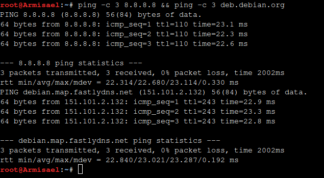
   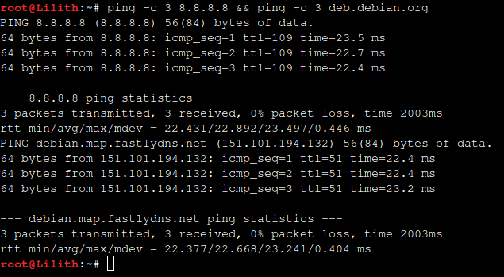
   *Baik `Armisael` maupun `Lilith` berhasil melakukan ping ke `8.8.8.8` dan me-resolve serta ping domain `deb.debian.org` (`debian.map.fastlydns.net`) dengan 0% packet loss.*

2. **Counter Rule NAT `POSTROUTING` di `Gendou`:**
   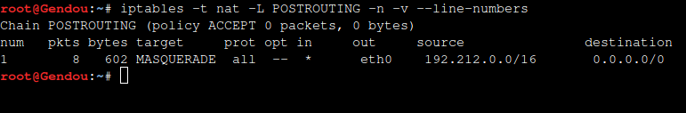
   *Rule #1 `MASQUERADE` dengan sumber `192.212.0.0/16` keluar `eth0` mencatat counter aktif (`8 pkts`, `602 bytes`), membuktikan translasi hanya terjadi pada trafik internal keluar menuju `NAT1`.*

---

## Soal 5 — Pintu Depan Dikunci Rapat

> Dikerjakan oleh Maulana Zaki Putra Zakaria

### Implementasi (`/root/gendo.sh`)
Seluruh konfigurasi `Gendou` (Soal 2–5) disatukan secara idempoten pada [`scripts/gendo.sh`](./scripts/gendo.sh) (`/root/gendo.sh`):
```sh
# Chain INPUT
iptables -A INPUT -i lo -j ACCEPT
iptables -A INPUT -m conntrack --ctstate ESTABLISHED,RELATED -j ACCEPT
iptables -A INPUT -i eth0 -p udp --sport 67 --dport 68 -j ACCEPT
iptables -A INPUT ! -i eth0 -s 192.212.0.0/16 -j ACCEPT

# Chain FORWARD
iptables -A FORWARD -m conntrack --ctstate ESTABLISHED,RELATED -j ACCEPT
iptables -A FORWARD ! -i eth0 -o eth0 -s 192.212.0.0/16 -j ACCEPT
iptables -A FORWARD ! -i eth0 ! -o eth0 -s 192.212.0.0/16 -d 192.212.0.0/16 -j ACCEPT

# Default Policy
iptables -P INPUT DROP
iptables -P FORWARD DROP
iptables -P OUTPUT ACCEPT
```
Koneksi baru dari sisi `NAT1` (`eth0`) otomatis ditolak oleh default policy `DROP`, sementara loopback, balasan DHCP (`udp 67->68`), koneksi `ESTABLISHED,RELATED`, akses internal ke internet, trafik antar-LAN, dan trafik internal ke `Gendou` tetap berjalan normal.

### Bukti dan Hasil
1. **Daftar Rule `iptables -S` & `iptables -t nat -S` di `Gendou`:**
   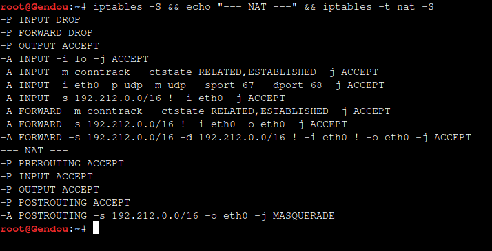
   *Default policy `INPUT` dan `FORWARD` telah dikunci menjadi `DROP`, dengan pengecualian loopback, DHCP `NAT1` (`udp 67->68`), stateful `RELATED,ESTABLISHED`, akses internal ke `Gendou`, internal ke internet (`eth0`), trafik antar-LAN, serta NAT `MASQUERADE`.*

2. **Bukti `Armisael` Tetap Bisa Ping `8.8.8.8`, Antar-LAN, dan ke `Gendou` Setelah Firewall Aktif:**
   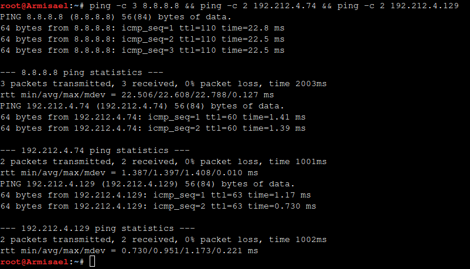
   *Ping dari `Armisael` menuju internet (`8.8.8.8`), `Lilith` (`192.212.4.74`), dan `Gendou` (`192.212.4.129`) seluruhnya tetap berjalan normal dengan 0% packet loss.*

---

## Soal 6 — Alamat Para Pilot

> Dikerjakan oleh Maulana Zaki Putra Zakaria

### Implementasi
Seluruh **25 node non-router** (seluruh 42 container menggunakan `ardhptr21/debinet:latest`) dikonfigurasi IP statis dan default gateway permanen di `/etc/network/interfaces` menggunakan [`scripts/soal-6-hosts-static.sh`](./scripts/soal-6-hosts-static.sh) (otomatis memasang `ifupdown` & `netcat-traditional`) serta mekanisme auto-recovery [`scripts/init.sh`](./scripts/init.sh).

### Bukti dan Hasil
- Verifikasi `ip -br -4 a`, `/etc/network/interfaces`, dan `ping` ke gateway `192.212.4.65` (`Misato`) pada **`Unit-01`** (`192.212.4.66/29`) setelah container di-restart:
  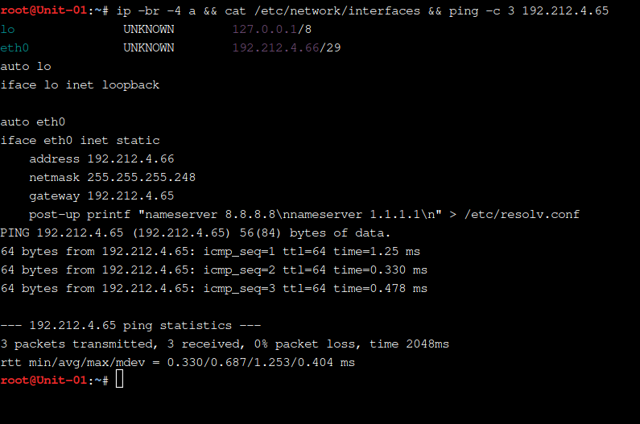
  *Setelah container `Unit-01` direstart, alamat IP `192.212.4.66/29`, subnet mask `255.255.255.248`, default gateway `192.212.4.65`, dan DNS resolver otomatis termuat kembali serta berhasil melakukan ping ke gateway `Misato` dengan 0% packet loss.*

---

## Soal 7 — Membangunkan MAGI

> Dikerjakan oleh Maulana Zaki Putra Zakaria

### Implementasi
Ketiga perangkat MAGI di `Switch-Terminal` dikonfigurasi melalui skrip masing-masing di `/root/`:
- [`scripts/casper.sh`](./scripts/casper.sh) (`/root/casper.sh`) → `Magi-Casper` (`192.212.4.58`), listener TCP **5000**
- [`scripts/balthasar.sh`](./scripts/balthasar.sh) (`/root/balthasar.sh`) → `Magi-Balthasar` (`192.212.4.59`), listener TCP **5000** & **5001**
- [`scripts/melchior.sh`](./scripts/melchior.sh) (`/root/melchior.sh`) → `Magi-Melchior` (`192.212.4.60`), listener TCP **5000**

### Bukti dan Hasil
1. **Pengiriman Pesan via `nc` dari `Lilith` ke 4 Port MAGI:**
   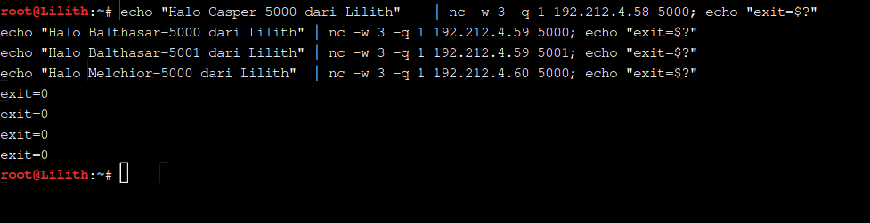
   *Pengiriman pesan dari `Lilith` (`192.212.4.74`) ke `Magi-Casper` (port `5000`), `Magi-Balthasar` (port `5000` & `5001`), dan `Magi-Melchior` (port `5000`) seluruhnya sukses dengan `exit=0`.*

2. **Pesan Masuk di `Magi-Casper` (`192.212.4.58`, TCP `5000`):**
   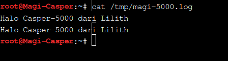

3. **Pesan Masuk di `Magi-Balthasar` (`192.212.4.59`, TCP `5000` & `5001`):**
   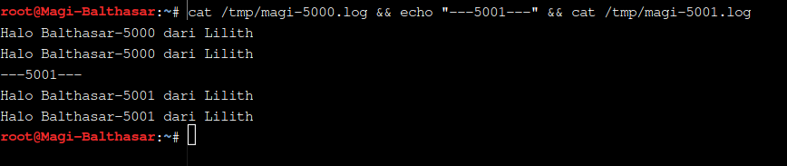

4. **Pesan Masuk di `Magi-Melchior` (`192.212.4.60`, TCP `5000`):**
   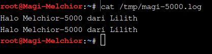
   *Seluruh pesan dari `Lilith` diterima secara persisten pada log listener masing-masing node MAGI (`/tmp/magi-5000.log` dan `/tmp/magi-5001.log`).*

---

## Soal 8 — Mengenali Kondisi Normal

> Dikerjakan oleh Maulana Zaki Putra Zakaria

### Implementasi
Layanan responder dikonfigurasi melalui [`scripts/penpen.sh`](./scripts/penpen.sh) dan [`scripts/tokyo3.sh`](./scripts/tokyo3.sh) menggunakan `netcat-traditional` (`nc -l -p <port> -e <handler>`):
- **`Pen-Pen` (`192.212.3.194`) port 80** → menjawab `Welcome to Pen-Pen`
- **`Tokyo3-Core` (`192.212.4.106`) port 80** → menjawab `Welcome to Tokyo3-Core`
- **`Tokyo3-Core` (`192.212.4.106`) port 8080** → menjawab `syifa imutz`

### Bukti dan Hasil
- Pengujian `nc` dari `Lilith` ke ketiga port layanan (berhasil semua dengan `exit=0`) serta pengujian port `22` yang tidak dilayani (`time nc -v -w 3 ... 22` langsung mengembalikan `Connection refused` dalam `0.34s–0.67s` dengan `exit=1` karena kernel tujuan membalas TCP `RST`, bukan menggantung hingga timeout 3 detik):
  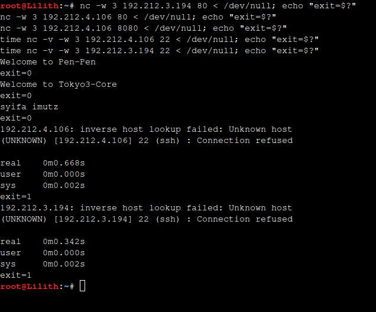
  *`Pen-Pen:80` menjawab `Welcome to Pen-Pen`, `Tokyo3-Core:80` menjawab `Welcome to Tokyo3-Core`, `Tokyo3-Core:8080` menjawab `syifa imutz` (semuanya `exit=0`), sedangkan port `22` pada kedua host langsung ditolak dengan `Connection refused` (`exit=1`).*

---

# Babak 2: Sabotase dan Hantu MAGI (Soal 9 – 12)

## Soal 9 — Jalur Belakang Diutak-Atik

> Dikerjakan oleh Maulana Zaki Putra Zakaria

### Analisis 4 Penyebab Sabotase (`break_routing.sh` di `Shigeru`)
Setelah menjalankan `break_routing.sh` di `Shigeru`, `Lilith` (`192.212.4.74`) tidak mendapat balasan ping dari `Armisael` (`192.212.4.83`), namun `Armisael` masih bisa ping gateway-nya (`192.212.4.81`). Hasil investigasi menemukan **4 penyebab sekaligus**:

1. **IPv4 Forwarding Dimatikan (`net.ipv4.ip_forward = 0`):** Shigeru berhenti meneruskan paket antar-interface. Ping dari `Armisael` ke gateway `192.212.4.81` tetap berhasil karena trafik lokal menuju router sendiri masuk chain `INPUT` dan tidak membutuhkan `ip_forward`.
2. **Default Route Dibelokkan ke `Makoto` (`default via 192.212.4.170 dev eth2`):** Seharusnya mengarah ke atas ke `Gendou` (`192.212.4.129 dev eth0`). Karena default route `Makoto` juga mengarah balik ke `Shigeru`, terjadi **routing loop** sampai TTL habis.
3. **Blackhole Route ke `Switch-Dogma` (`blackhole 192.212.4.72/29`):** Karena `/29` lebih spesifik (*longest-prefix match*) daripada default route, paket balasan menuju subnet `Lilith` langsung dibuang diam-diam oleh Shigeru.
4. **Policy-Based Routing (PBR) `ip rule` + Table `100`:** Rule `priority 90: from all iif eth1 lookup 100` dievaluasi sebelum tabel `main` (`priority 32766`), dan isi table `100` adalah `unreachable default`. Akibatnya, semua trafik dari LAN `Switch-Monolith` (`eth1`) yang hendak keluar subnet langsung dinyatakan *unreachable*, sementara ping ke gateway sendiri tetap sukses karena `priority 0: lookup local` tetap dieksekusi lebih dulu.

### Perbaikan
Dilakukan melalui [`scripts/soal-9-fix-shigeru.sh`](./scripts/soal-9-fix-shigeru.sh):
```sh
sysctl -w net.ipv4.ip_forward=1
ip route replace default via 192.212.4.129 dev eth0
ip route del blackhole 192.212.4.72/29
ip rule del iif eth1 lookup 100 priority 90
ip route flush table 100
```

### Bukti dan Hasil
1. **Gejala Sabotase (`Lilith` Gagal Ping `Armisael`, Namun `Armisael` Tetap Bisa Ping Gateway `Shigeru`):**
   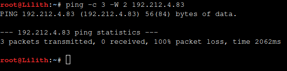
   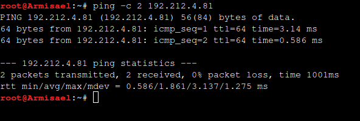
   *Saat sabotase aktif, ping dari `Lilith` ke `Armisael` (`192.212.4.83`) mengalami 100% packet loss, sementara `Armisael` masih dapat melakukan ping ke gateway-nya (`192.212.4.81`) dengan 0% packet loss.*

2. **Diagnosis 4 Penyebab & Perbaikan di `Shigeru` (`diagnose` dan `fix`):**
   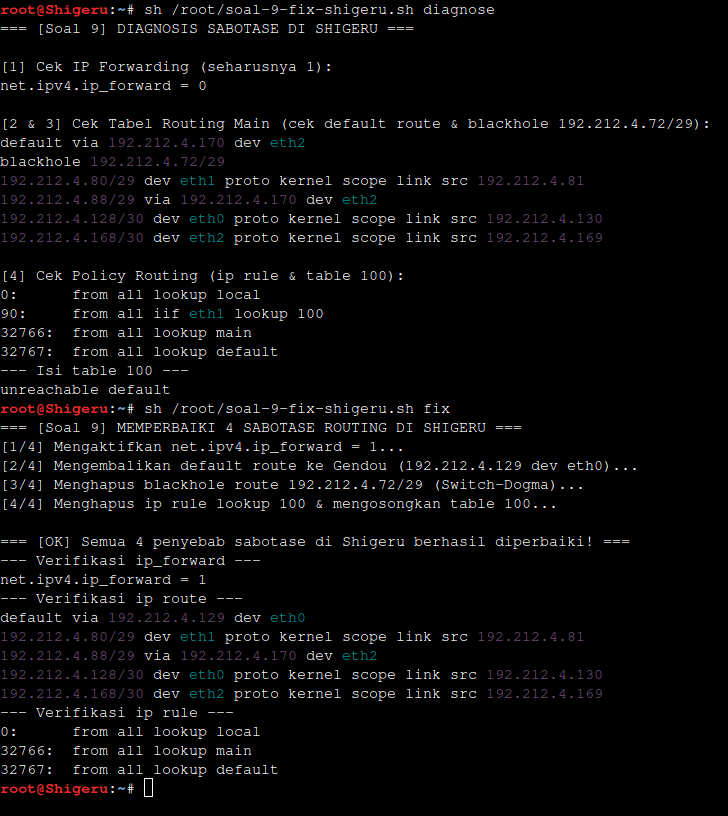
   *Terlihat jelas seluruh 4 kerusakan (`net.ipv4.ip_forward = 0`, `default via 192.212.4.170 dev eth2`, `blackhole 192.212.4.72/29`, serta `ip rule` priority `90` ke `table 100` berisi `unreachable default`) dan seluruhnya berhasil dipulihkan.*

3. **Setelah Perbaikan (`Lilith` Kembali Berhasil Ping `Armisael`):**
   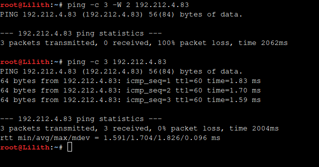
   *Perbandingan sebelum dan sesudah perbaikan: ping `Lilith` ke `192.212.4.83` (`Armisael`) pulih menjadi 0% packet loss (`ttl=60`, RTT `1.59–1.83 ms`).*

---

## Soal 10 — Para Pilot Terkunci di Dalam

> Dikerjakan oleh Maulana Zaki Putra Zakaria

### Analisis 2 Penyebab Sabotase (`break_nat.sh` di `Misato` & `Gendou`)
1. **Di `Misato` (SNAT Palsu):** Terdapat rule `iptables -t nat -A POSTROUTING -s 192.212.4.64/29 ! -d 192.212.0.0/16 -o eth0 -j SNAT --to-source 172.31.99.1`.
   - Saat host di `Switch-Cage` (`Unit-01/02/00`) melakukan ping ke `8.8.8.8` (di luar `192.212.0.0/16`), `Misato` mengganti IP sumbernya menjadi `172.31.99.1`. Ketika tiba di `Gendou`, paket langsung dibuang oleh firewall `FORWARD DROP` (yang hanya mengizinkan `-s 192.212.0.0/16`) sekaligus tidak cocok dengan rule `MASQUERADE`.
   - Ping dari `Cage` ke `Lilith` (`192.212.4.74`) **tetap normal** karena tujuan berada di dalam `192.212.0.0/16` (tidak memenuhi `! -d 192.212.0.0/16`).
   - `Spy` di `Switch-Intel` (`192.212.4.102`, subnet `192.212.4.100/30`) **tidak terdampak** karena melewati router `Kaji` (bukan `Misato`) dan tidak cocok dengan `-s 192.212.4.64/29`.
2. **Di `Gendou` (Rule `RETURN` Posisi #1):** Terdapat rule `iptables -t nat -I POSTROUTING 1 -s 192.212.4.64/29 -o eth0 -j RETURN` tepat di atas rule `MASQUERADE`.
   - Meskipun SNAT palsu di `Misato` sudah dihapus, paket dari `Switch-Cage` yang keluar lewat `eth0` di `Gendou` langsung keluar dari chain `POSTROUTING` (bypass `MASQUERADE`) sehingga meluncur ke `NAT1` dengan IP privat `192.212.4.66` tanpa diterjemahkan.

### Jawaban Lokasi Translasi Alamat Sumber
- **Saat sabotase:** Alamat sumber `Switch-Cage` diterjemahkan secara keliru di router **`Misato`** menjadi `172.31.99.1`, dan gagal diterjemahkan di **`Gendou`** akibat rule `RETURN`.
- **Setelah perbaikan (kondisi benar):** Alamat sumber diterjemahkan **hanya di router `Gendou`** (`table nat`, chain `POSTROUTING`, keluar `eth0` dengan `MASQUERADE`). Router `Misato` tidak melakukan NAT sama sekali.

### Perbaikan
Dilakukan pada `Misato` dan `Gendou` menggunakan [`scripts/soal-10-fix-nat.sh`](./scripts/soal-10-fix-nat.sh).

### Bukti dan Hasil
1. **Gejala Sabotase (`Unit-01` Gagal ke `8.8.8.8` Namun Sukses ke `Lilith`, Sedangkan `Spy` Tetap Sukses ke `8.8.8.8`):**
   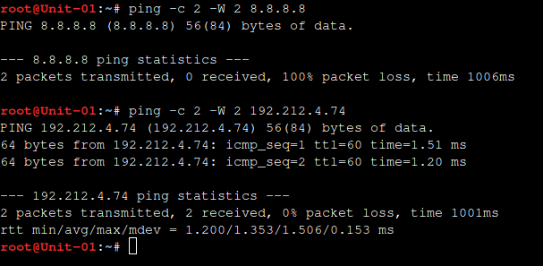
   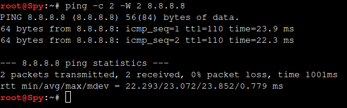
   *Saat sabotase aktif, `Unit-01` (`Switch-Cage`) mengalami 100% packet loss ke `8.8.8.8`, tetapi ping antar-LAN ke `Lilith` (`192.212.4.74`) dan ping internet dari `Spy` (`Switch-Intel`) sama-sama tetap 0% packet loss.*

2. **Diagnosis & Perbaikan Tabel NAT di `Misato` dan `Gendou`:**
   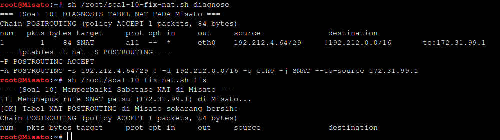
   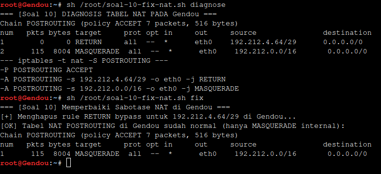
   *Terbukti pada `Misato` terdapat rule SNAT palsu `to:172.31.99.1` (tercatat `1 pkt, 84 bytes` yang mencegat paket internet `Unit-01`) dan pada `Gendou` terdapat rule #1 `RETURN` untuk `192.212.4.64/29` tepat di atas `MASQUERADE`. Setelah diperbaiki, chain `POSTROUTING` di `Misato` kosong total dan di `Gendou` kembali hanya berisi rule `MASQUERADE` `192.212.0.0/16` keluar `eth0`.*

3. **Setelah Perbaikan (`Unit-01` Kembali Berhasil Ping `8.8.8.8`):**
   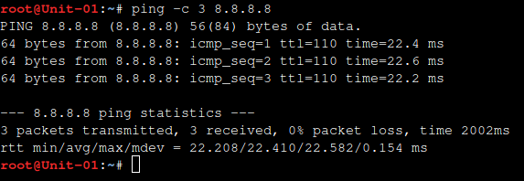
   *Setelah kedua rule sabotase dihapus, `Unit-01` kembali dapat mengakses internet (`8.8.8.8`) dengan 0% packet loss (`ttl=110`, RTT `22.2–22.6 ms`).*

---

## Soal 11 — Casper Harus Jadi Hantu

> Dikerjakan oleh Maulana Zaki Putra Zakaria

### Implementasi
Karena perangkat satu switch (`Magi-Balthasar` dan `Magi-Melchior` di `Switch-Terminal`) berkomunikasi langsung pada Layer 2 tanpa melewati router `Fuyutsuki`, aturan wajib dipasang sebagai **host-based firewall** di `Magi-Casper` sendiri melalui [`scripts/soal-11-casper-ghost.sh`](./scripts/soal-11-casper-ghost.sh):
```sh
iptables -A INPUT -p icmp --icmp-type echo-request -j DROP
```
- Dengan menyaring khusus `--icmp-type echo-request`, semua ping **masuk** ke Casper dibuang diam-diam, tetapi `echo-reply` untuk ping yang **dimulai Casper sendiri** tetap lolos. Layanan TCP `5000` tetap berjalan normal.

### Bukti dan Hasil
1. **Ping dari `Magi-Balthasar` (Satu Switch) & `Lilith` ke `Magi-Casper` Gagal, Namun TCP `5000` Tetap Hidup:**
   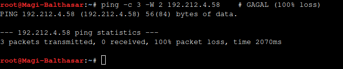
   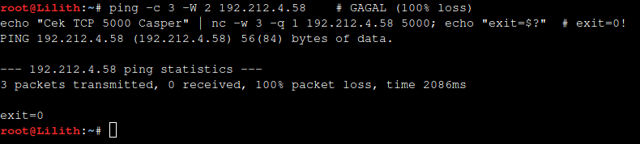
   *Baik `Magi-Balthasar` (satu switch `Switch-Terminal`) maupun `Lilith` mengalami 100% packet loss saat mem-ping `192.212.4.58`, sementara pengiriman pesan TCP port `5000` dari `Lilith` ke `Magi-Casper` tetap berhasil (`exit=0`).*

2. **Ping dari `Magi-Casper` ke `Magi-Balthasar` & `Lilith` Berhasil + Counter `iptables`:**
   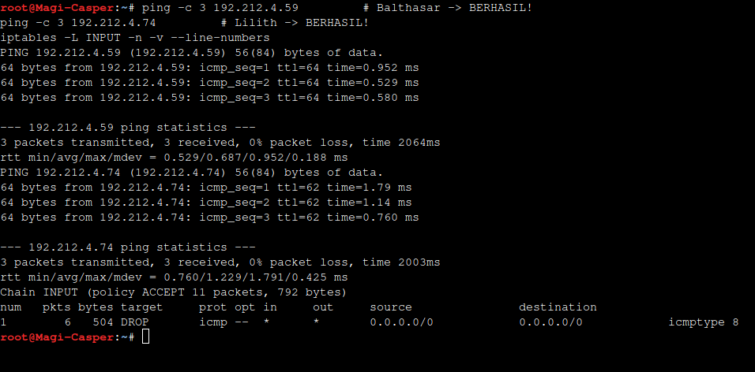
   *`Magi-Casper` tetap bisa mem-ping `Magi-Balthasar` (`0% loss`, `ttl=64`) dan `Lilith` (`0% loss`, `ttl=62`), sementara rule `DROP icmp icmptype 8` mencatat tepat `6 pkts` (`504 bytes`) yang dibuang (3 dari `Balthasar` + 3 dari `Lilith`).*

---

## Soal 12 — Teknisi yang Kelewat Semangat

> Dikerjakan oleh Maulana Zaki Putra Zakaria

### Analisis 4 Kesalahan Hardening (`break_fw.sh` di `Magi-Casper`)
1. **Tidak ada rule stateful `ESTABLISHED,RELATED` di `INPUT` dengan policy `INPUT DROP`:** Semua paket balasan untuk koneksi keluar Casper (balasan `ping 8.8.8.8`, balasan query DNS, dan paket HTTP repositori `apt-get update`) jatuh ke policy `DROP`.
2. **Rule `INPUT -p icmp -j DROP` terlalu luas:** Memblokir seluruh tipe ICMP termasuk `echo-reply`.
3. **Rule `OUTPUT -p udp --dport 53 -j DROP`:** Memblokir pengiriman query DNS keluar sehingga `apt-get update` gagal me-resolve `deb.debian.org`.
4. **TCP port `5000` belum dibuka di `INPUT`:** Koneksi `nc` dari `Unit-00` ke layanan MAGI port 5000 dibuang oleh policy `INPUT DROP`.

### Perbaikan Tanpa Membatalkan Tujuan Hardening
Diterapkan melalui [`scripts/soal-12-fix-casper-fw.sh`](./scripts/soal-12-fix-casper-fw.sh) dengan **tetap mempertahankan `policy INPUT DROP`**:
```sh
iptables -A INPUT -i lo -j ACCEPT
iptables -A INPUT -m conntrack --ctstate ESTABLISHED,RELATED -j ACCEPT
iptables -A INPUT -p icmp --icmp-type echo-request -j DROP
iptables -A INPUT -p tcp --dport 5000 -j ACCEPT
iptables -P INPUT DROP
```
Rule `OUTPUT -p udp --dport 53 -j DROP` dihapus sehingga DNS keluar kembali berfungsi, sementara seluruh trafik masuk yang tidak diizinkan tetap diblokir dan ping masuk ke Casper tetap ditolak.

### Bukti dan Hasil
1. **Gejala Sabotase (`Magi-Casper` Gagal `ping 8.8.8.8` & `apt-get update`, `Unit-00` Gagal `nc` Port `5000`):**
   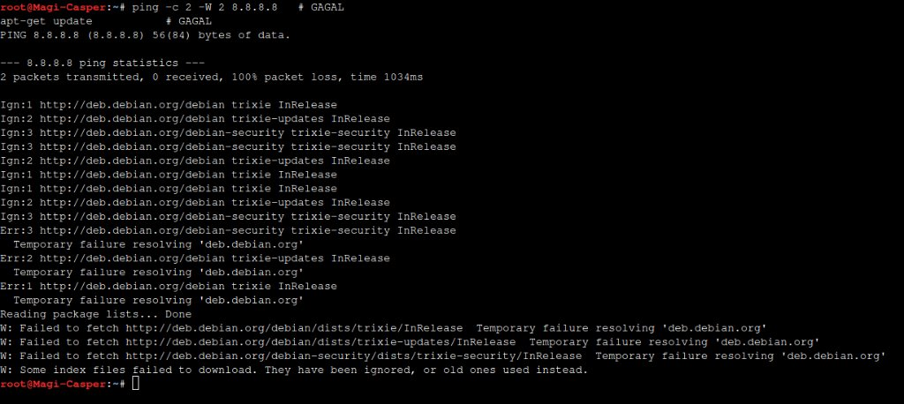
   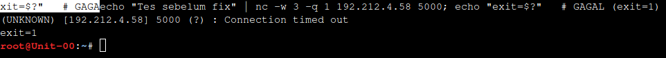
   *Akibat `break_fw.sh`, `ping 8.8.8.8` di `Magi-Casper` mengalami 100% packet loss, `apt-get update` gagal me-resolve `deb.debian.org`, dan `nc` dari `Unit-00` ke `192.212.4.58:5000` berakhir `Connection timed out` (`exit=1`).*

2. **Diagnosis 4 Kesalahan Hardening & Perbaikan di `Magi-Casper` (`diagnose` dan `fix`, Policy `INPUT DROP` Tetap Terjaga):**
   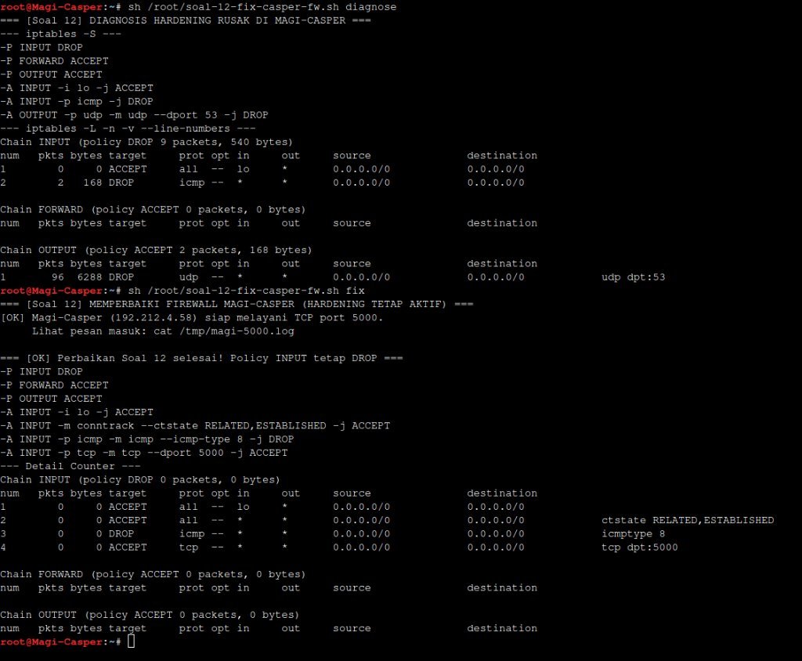
   *Counter `diagnose` membuktikan secara langsung penyebab tiap gejala: `INPUT policy DROP` membuang `9 pkts` (`Unit-00:5000`), `INPUT -p icmp -j DROP` membuang `2 pkts` (`echo-reply 8.8.8.8`), dan `OUTPUT -p udp --dport 53 -j DROP` membuang `96 pkts` (query DNS `apt-get update`). Setelah `fix`, policy `-P INPUT DROP` tetap dipertahankan bersama aturan loopback, `RELATED,ESTABLISHED`, `icmp-type 8 DROP`, dan TCP `5000 ACCEPT`.*

3. **Bukti Setelah Perbaikan (`Unit-00` Sukses `nc` Port `5000` Namun Ping Tetap Ditolak; `Magi-Casper` Sukses `ping 8.8.8.8`, `apt-get update`, & Menerima Pesan):**
   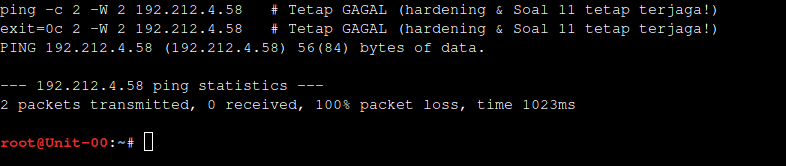
   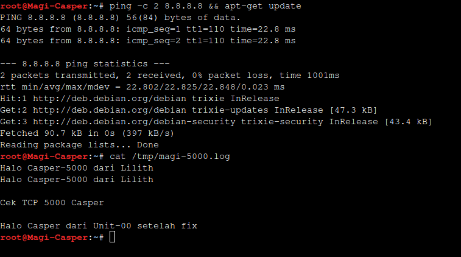
   *`Magi-Casper` kembali berhasil melakukan `ping 8.8.8.8` (`0% loss`), `apt-get update` (`Fetched 90.7 kB in 0s`), dan menerima pesan `Halo Casper dari Unit-00 setelah fix` di `/tmp/magi-5000.log` (`exit=0`), sementara ping masuk dari `Unit-00` tetap 100% ditolak sesuai hardening & Soal 11.*

---

# Babak 3 & Final: Mengamankan MAGI, Zona Sensitif & Uji Kebakaran (Soal 13 – 20)

> Bagian ini dikerjakan oleh **Naila Anggun Eka Rizqy** (5027251122).

## Soal 13 — Brankas Balthasar

> Dikerjakan oleh Naila Anggun Eka Rizqy (5027251122)

### Implementasi
Karena `Magi-Melchior` (`192.212.4.60`) berada satu switch Layer 2 (`Switch-Terminal`, `192.212.4.56/29`) dengan `Magi-Balthasar` (`192.212.4.59`), pembatasan diterapkan langsung pada firewall host `Magi-Balthasar` melalui [`scripts/soal-13-balthasar.sh`](./scripts/soal-13-balthasar.sh) (dijalankan sebagai `/root/balthasar.sh`):
- Mengizinkan `lo` dan koneksi `ESTABLISHED,RELATED` agar `Magi-Balthasar` tetap bisa melakukan `ping 8.8.8.8` dan menerima balasannya.
- Mengizinkan TCP port `5000` dan `5001` hanya untuk `Magi-Casper` (`192.212.4.58`) serta seluruh **Pilot** (`Unit-01` `192.212.4.66`, `Unit-02` `192.212.4.67`, `Unit-00` `192.212.4.68`, dan `Sachiel` `192.212.3.130`).
- Menolak koneksi lain (termasuk tetangga satu switch `Magi-Melchior` dan `Lilith`) ke port `5000` dan `5001` secara langsung memakai `-j REJECT --reject-with tcp-reset` sehingga koneksi langsung gagal (`exit=1`) tanpa menunggu timeout, sambil menjaga lalu lintas lain tetap berjalan normal.

### Bukti dan Hasil
1. **Koneksi `nc` dari `Unit-01` ke Port `5000` & `5001` Berhasil (`exit=0`) serta Log di `Magi-Balthasar`:**
   
   *Pengiriman pesan dari `Unit-01` (`192.212.4.66`) ke `192.212.4.59` port `5000` dan `5001` berhasil (`exit=0`) dan tercatat pada log listener `Magi-Balthasar`.*

2. **Koneksi dari `Lilith` & `Magi-Melchior` Ditolak Seketika serta `Magi-Balthasar` Tetap Bisa Ping `8.8.8.8`:**
   
   *Percobaan `nc` dari `Lilith` (`192.212.4.74`) dan `Magi-Melchior` (`192.212.4.60`) ke port `5000` dan `5001` langsung ditolak (`exit=1` dalam waktu singkat, tidak menggantung), sementara `Magi-Balthasar` tetap dapat mem-ping `8.8.8.8` dengan `0% packet loss`.*

   ## Soal 14 — Jam Kunjungan Sang Pinguin

> Dikerjakan oleh Naila Anggun Eka Rizqy (5027251122)

### Implementasi
Akses ICMP (`ping`) dan TCP port `80` menuju **`Pen-Pen`** (`192.212.3.194`) diatur melalui [`scripts/soal-14-penpen.sh`](./scripts/soal-14-penpen.sh) (disimpan di `/root/penpen.sh` dan dipanggil otomatis dari `/etc/network/interfaces`) menggunakan modul `iptables -m time`. Karena `iptables` membaca waktu dalam zona **UTC** (7 jam lebih lambat dari WIB), jadwal pada variabel awal skrip disesuaikan dengan konversi tersebut:
- **Pilot** (`Unit-01` `192.212.4.66`, `Unit-02` `192.212.4.67`, `Unit-00` `192.212.4.68`, `Sachiel` `192.212.3.130`): `08.00–16.00 WIB` Senin–Jumat $\rightarrow$ `PILOT_START="01:00"`, `PILOT_STOP="09:00"`, `PILOT_DAYS="Mon,Tue,Wed,Thu,Fri"` (di luar jadwal di-`DROP`).
- **Staf Geofront** (`Lilith` `192.212.4.74`, `Adam` `192.212.4.75`): `17.00–23.00 WIB` setiap hari $\rightarrow$ `STAF_START="10:00"`, `STAF_STOP="16:00"` (di luar jadwal di-`DROP`).
- **Terduga Dummy System** (`Entry-Plug` `192.212.4.50`, `Dummy-Plug` `192.212.4.51`, `Spy` `192.212.4.102`): selalu di-`DROP`.
- **Lainnya**: bebas tanpa batasan jadwal.

### Bukti dan Hasil
1. **Kondisi 1 — Variabel Jadwal Disesuaikan Cocok dengan Jam UTC Saat Pengujian (`date -u`):**
   
   *Saat variabel jadwal disesuaikan mencakup jam UTC aktual, `Unit-01` (Pilot) dan `Lilith` (Staf Geofront) berhasil mem-ping `Pen-Pen` (`0% packet loss`), sedangkan `Spy` (Terduga Dummy System) tetap gagal (`100% packet loss`).*

2. **Kondisi 2 — Variabel Jadwal Diubah Tidak Cocok dengan Jam UTC Saat Pengujian:**
   
   *Saat variabel jadwal digeser ke luar jam UTC aktual, `Unit-01`, `Lilith`, dan `Spy` seluruhnya mengalami `100% packet loss` saat mem-ping `192.212.3.194`.*

   ## Soal 15 — Banjir Ping di Pusat Komando

> Dikerjakan oleh Naila Anggun Eka Rizqy (5027251122)

### Implementasi
Pembatasan laju ping masuk dikonfigurasi pada **`Tokyo3-Core`** (`192.212.4.106`) melalui fungsi `apply_firewall()` di dalam [`scripts/soal-15-16-tokyo3.sh`](./scripts/soal-15-16-tokyo3.sh) (disimpan sebagai `/root/tokyo3.sh` dan dipanggil otomatis dari `/etc/network/interfaces`):
- Aturan pada chain `INPUT` menyaring secara spesifik paket `-p icmp --icmp-type echo-request` dengan `-m limit --limit 5/sec --limit-burst 5 -j ACCEPT`, diikuti `-p icmp --icmp-type echo-request -j DROP` untuk membuang kelebihan paket di atas batas maksimal 5 ping per detik.
- Karena aturan hanya mencocokkan `echo-request` masuk pada `INPUT`, ping normal di bawah batas tidak terganggu dan balasan (`echo-reply`) atas ping yang dikirim `Tokyo3-Core` sendiri tetap lolos tanpa terkena rate limit.

### Bukti dan Hasil
1. **Uji Ping Rapat (`ping -i 0.1 -c 50`) vs Ping Normal Jeda Minimal 3 Detik dari `Lilith`:**
   
   *Saat `Lilith` mengirim ping rapat (`ping -i 0.1 -c 50` ke `192.212.4.106`), sebagian paket terbuang (`packet loss` sekitar 50%), sedangkan saat dikirim dengan jeda minimal 3 detik antar paket (`ping -i 3 -c 4`), seluruh paket berhasil terjawab dengan `0% packet loss`.*

2. **Counter Rule Pembuangan (`DROP`) & Ping Keluar dari `Tokyo3-Core`:**
   
   *Output `iptables -L INPUT -n -v --line-numbers` menunjukkan counter pada rule `DROP` naik setelah banjir ping, sementara ping yang dimulai dari `Tokyo3-Core` sendiri berjalan normal.*

## Soal 16 — Pencuri yang Mencoba Setiap Pintu

> Dikerjakan oleh Naila Anggun Eka Rizqy (5027251122)

### Implementasi
Pada **`Tokyo3-Core`** (`192.212.4.106`), aturan deteksi percobaan akses ke port sensitif dari **`Dummy-Plug`** (`192.212.4.51`) ditambahkan ke dalam fungsi `apply_firewall()` pada [`scripts/soal-15-16-tokyo3.sh`](./scripts/soal-15-16-tokyo3.sh) (disimpan di `/root/tokyo3.sh`):
- Setiap paket TCP `SYN` dari `192.212.4.51` menuju port `22`, `23`, dan `3306` dicatat melalui target `-j LOG --log-prefix "SCAN-NERV: "` sebelum diteruskan ke `-j REJECT --reject-with tcp-reset` agar koneksi langsung ditolak seketika tanpa menggantung[cite: 4, 7, 12, 13].
- Port layanan `80` (`Welcome to Tokyo3-Core`) dan `8080` (`syifa imutz`) tetap terbuka dan dapat diakses normal, serta lalu lintas dari node lain tidak terganggu[cite: 10, 12, 13].

### Bukti dan Hasil
1. **Uji `nc -w` dari `Dummy-Plug` ke Port `22`, `23`, `3306` (Ditolak Seketika) vs Port `80` & `8080` (Berhasil):**
   
   *Percobaan koneksi dari `Dummy-Plug` (`192.212.4.51`) ke port `22`, `23`, dan `3306` pada `192.212.4.106` langsung ditolak (`exit=1`), sedangkan akses ke port `80` dan `8080` tetap berhasil (`exit=0`)[cite: 12, 13].*

2. **Counter Rule `LOG` (`SCAN-NERV:`) dan `REJECT` pada `iptables -L INPUT -n -v` di `Tokyo3-Core`:**
   
   *Counter paket dan byte pada rule `LOG` dengan prefix `"SCAN-NERV: "` serta rule `REJECT` di `Tokyo3-Core` meningkat sesuai jumlah percobaan koneksi ke port `22`, `23`, dan `3306`[cite: 12, 13].*

## Soal 17 — Sihir Hitam di Jalur Paket

> Dikerjakan oleh Naila Anggun Eka Rizqy (5027251122)

### Implementasi
Pada router gateway `Switch-Terminal`, yaitu **`Fuyutsuki`**, aturan pengalihan paket dikonfigurasi melalui [`scripts/soal-17-fuyutsuki-trap.sh`](./scripts/soal-17-fuyutsuki-trap.sh) (disimpan di `/root/fuyutsuki-trap.sh` dan dipanggil otomatis dari `/etc/network/interfaces`):
- Aturan `iptables -t nat -A PREROUTING -s 192.212.4.58 -d 192.212.4.82 -p tcp -j DNAT --to-destination 192.212.3.194` mengalihkan koneksi TCP dari **`Magi-Casper`** (`192.212.4.58`) menuju **`Zeruel`** (`192.212.4.82`) agar diarahkan ke **`Pen-Pen`** (`192.212.3.194`).
- Aturan `iptables -t nat -A POSTROUTING -s 192.212.4.58 -d 192.212.3.194 -p tcp -j SNAT --to-source 192.212.4.161` memastikan paket balasan dari `Pen-Pen` melewati `Fuyutsuki` dan dipetakan balik oleh `conntrack` seolah datang dari IP `Zeruel` (`192.212.4.82`) tanpa disadari `Magi-Casper`.
- Karena penyaringan hanya mencocokkan `-p tcp`, trafik ICMP (`ping`) dari `Magi-Casper` ke `Zeruel` tidak ikut dialihkan.

### Bukti dan Hasil
1. **Pengiriman Pesan TCP Port `9000` dari `Magi-Casper` ke `192.212.4.82` & Log pada `Pen-Pen` vs `Zeruel`:**
   
   *Pesan yang dikirim `Magi-Casper` ke port `9000` IP `Zeruel` tercatat di `/tmp/penpen-9000.log` pada `Pen-Pen`, sedangkan `/tmp/zeruel-9000.log` pada `Zeruel` tetap kosong.*

2. **Tabel `conntrack` dan Counter NAT di `Fuyutsuki`:**
   
   *Entri `conntrack` pada `Fuyutsuki` menunjukkan aliran TCP ke port `9000` dari `192.212.4.58` ditranslasikan destinasinya ke `192.212.3.194` beserta translasi balik.*

---

## Soal 18 — Gerbang Monolith dan Radar

> Dikerjakan oleh Naila Anggun Eka Rizqy (5027251122)

### Implementasi
Pengamanan zona sensitif (`Switch-Monolith` dan `Switch-Radar`) dikonfigurasi pada router **`Shigeru`** melalui [`scripts/soal-18-19-shigeru.sh`](./scripts/soal-18-19-shigeru.sh) (disimpan di `/root/shigeru.sh` dan dipanggil otomatis dari `/etc/network/interfaces`):
- Aturan `iptables -A FORWARD -m conntrack --ctstate ESTABLISHED,RELATED -j ACCEPT` mengizinkan balasan dari koneksi yang memang dimulai oleh node di dalam zona sensitif.
- Aturan `iptables -A FORWARD -i eth0 -s 192.212.4.56/29 -p icmp --icmp-type echo-request -j ACCEPT` mengizinkan ping (`echo-request`) baru dari subnet `Switch-Terminal` (`192.212.4.56/29`) menuju zona sensitif.
- Aturan `iptables -A FORWARD -i eth0 -j DROP` menutup koneksi baru lain yang datang dari sisi `Gendou` (`eth0`) ke zona Monolith & Radar tanpa perlu mendaftarkan satu per satu subnet di luar zona.

### Bukti dan Hasil
1. **Koneksi Keluar dari Zona Sensitif & Ping dari `Switch-Terminal` (`192.212.4.56/29`):**
   
   *Node di dalam zona (`Switch-Monolith` / `Switch-Radar`) tetap dapat memulai koneksi keluar, dan ping dari `Switch-Terminal` ke zona sensitif berhasil (`0% packet loss`).*

2. **Pemblokiran Koneksi Baru dari Luar Zona (`Switch-Dummy` / `Switch-Geofront`):**
   
   *Koneksi baru dari luar zona yang masuk melalui `eth0` pada `Shigeru` ditolak (`DROP`), sementara balasan untuk sesi yang dimulai dari dalam zona tetap lolos.*

---

## Soal 19 — Isolasi Armisael

> Dikerjakan oleh Naila Anggun Eka Rizqy (5027251122)

### Implementasi
Isolasi host **`Armisael`** (`192.212.4.83`) dilakukan secara bertingkat pada router **`Shigeru`** melalui [`scripts/soal-18-19-shigeru.sh`](./scripts/soal-18-19-shigeru.sh) dan pada lapisan bridge/host GNS3 melalui [`scripts/soal-19-host-isolasi-armisael.sh`](./scripts/soal-19-host-isolasi-armisael.sh):
- Pada `Shigeru` (`iptables`), trafik `FORWARD` yang berasal dari maupun menuju `192.212.4.83` (serta `INPUT` dari `192.212.4.83`) di-`DROP` agar lintas-subnet terputus.
- Karena aturan `iptables` di dalam container `Armisael` sendiri berisiko dimanipulasi dan tidak menghalangi trafik Layer 2 satu switch menuju **`Zeruel`**, pemblokiran frame berdasarkan alamat MAC `Armisael` diterapkan melalui `ebtables` pada bridge/host GNS3 tanpa mengganggu komunikasi `Zeruel`.

### Bukti dan Hasil
1. **Keterputusan Komunikasi `Armisael` (`192.212.4.83`) Menuju Gateway & `Zeruel`:**
   
   *`Armisael` gagal menjangkau gateway maupun `Zeruel` (`100% packet loss` / koneksi gagal), dan tidak ada trafik dari `Armisael` yang masuk ke `Zeruel`.*

2. **Kelangsungan Komunikasi `Zeruel` ke Jaringan & Gateway:**
   
   *`Zeruel` tetap dapat mengirim dan menerima trafik normal ke gateway dan host lain selama `Armisael` diisolasi.*

---

## Soal 20 — Uji Kebakaran Geofront

> Dikerjakan oleh Naila Anggun Eka Rizqy (5027251122)

### Implementasi
Prosedur penyimpanan, penghapusan, dan pemulihan konfigurasi firewall/NAT secara idempoten diuji menggunakan [`scripts/soal-20-uji-kebakaran.sh`](./scripts/soal-20-uji-kebakaran.sh) (disimpan di `/root/uji-kebakaran.sh` pada node uji):
- Konfigurasi aktif disimpan ke berkas menggunakan `iptables-save`, kemudian seluruh chain dan tabel `filter` serta `nat` dibersihkan (`iptables -F`, `iptables -X`, `iptables -t nat -F`, `iptables -t nat -X`) dan policy dikembalikan ke `ACCEPT`.
- Pemulihan dijalankan **dua kali berturut-turut** (`iptables-restore` dan eksekusi ulang skrip konfigurasi node), lalu jumlah baris aturan pada `iptables -S` dan `iptables -t nat -S` dibandingkan antara pemulihan pertama dan kedua untuk memastikan tidak ada duplikasi maupun rule yang hilang.

### Bukti dan Hasil
1. **Hasil Pemulihan Berulang (`iptables-restore` & Eksekusi Ulang Skrip 2x Berturut-turut):**
   
   *Jumlah baris aturan pada `iptables -S` dan `iptables -t nat -S` pada pemulihan ke-1 dan ke-2 identik, membuktikan skrip konfigurasi idempoten dan aman dijalankan ulang.*

2. **Verifikasi Fungsi Firewall & NAT Setelah Pemulihan:**
   
   *Aturan `iptables -L -n -v` dan `iptables -t nat -L -n -v` tetap aktif sesuai kebijakan masing-masing node setelah proses pemulihan selesai.*
```[cite: 5, 6, 7, 8, 9]